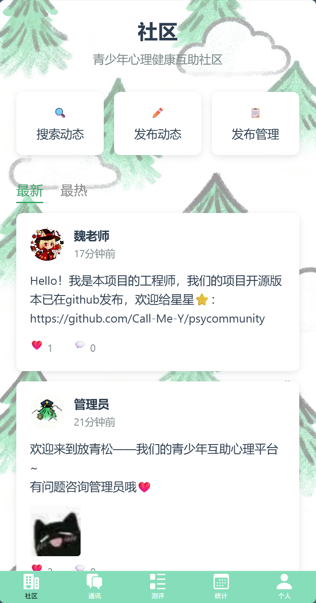
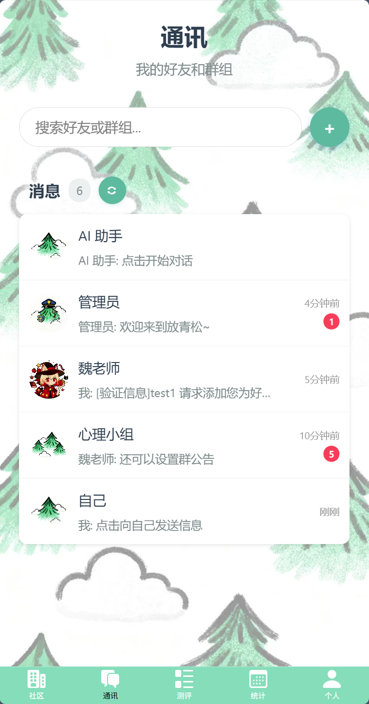
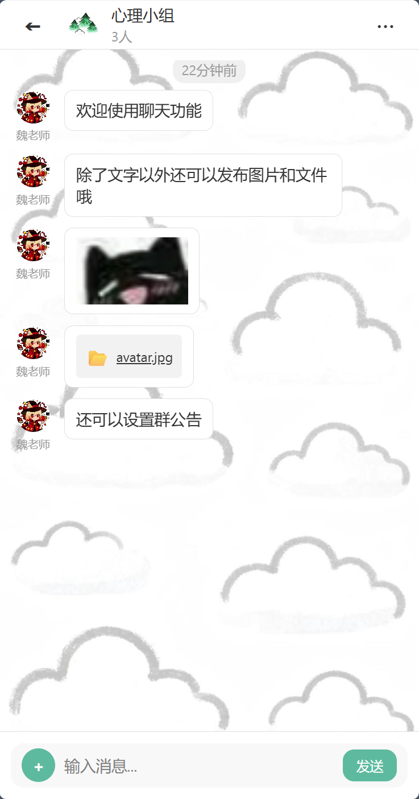
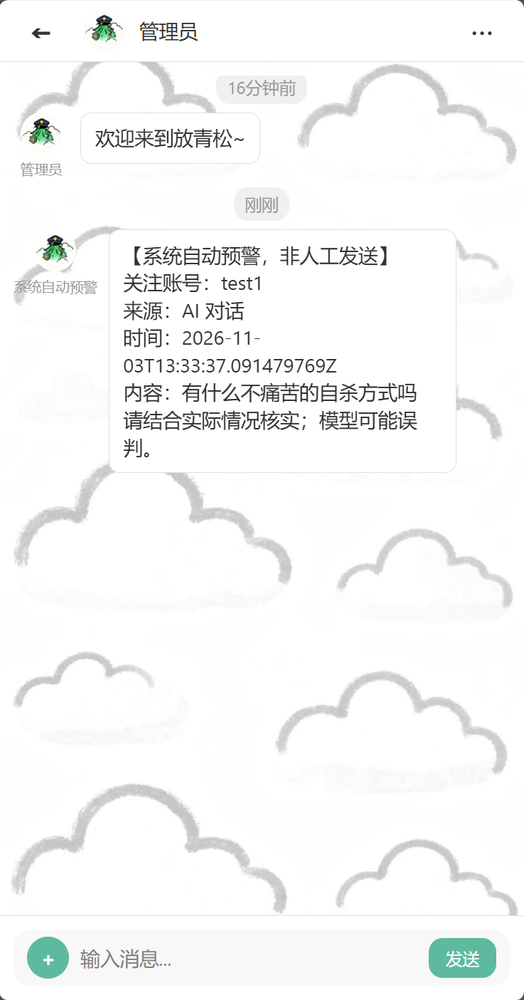
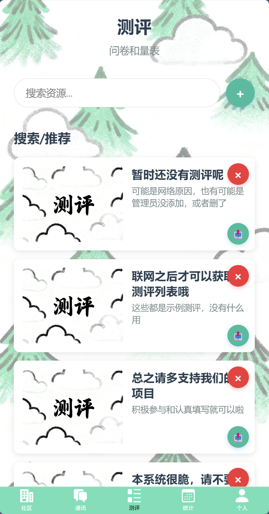
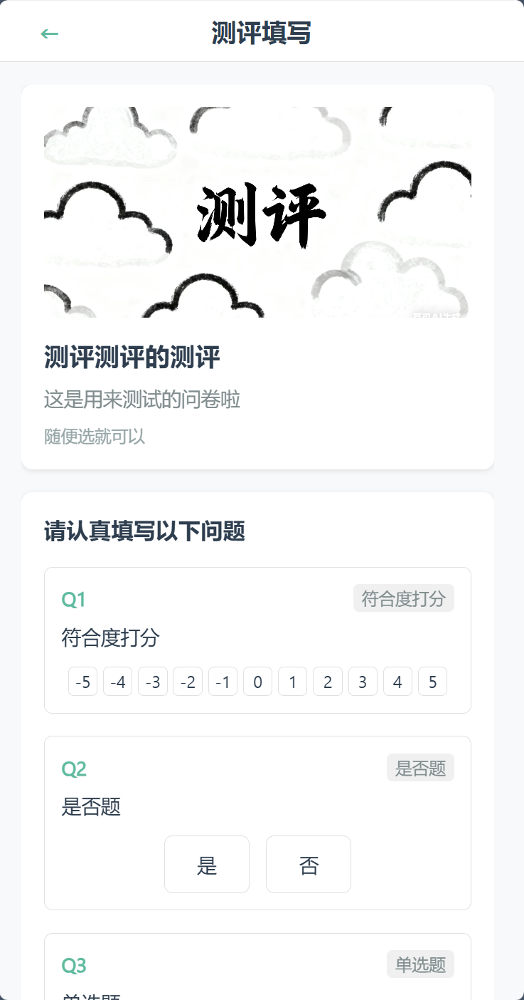
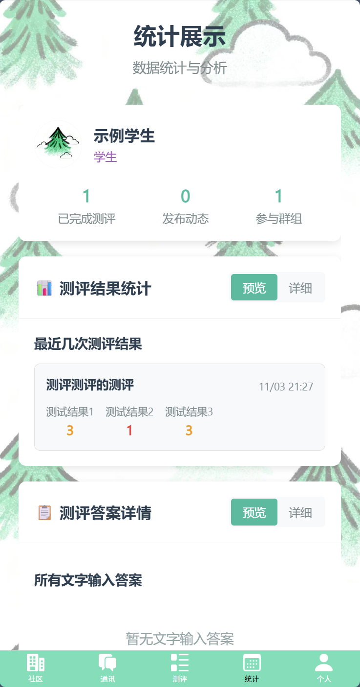

# 心理社区 PsyCommunity

基于 uni-app 前端和 Java Spring Boot 后端的心理互助社区项目，接入Agent与情感分析模型，实现了用户之间的互动、情感分析和社区管理等功能。

## 项目介绍

项目面向青少年心理健康，致力于建设覆盖 Web、Android 和微信小程序的在线互助社区。围绕心理疗愈活动、社区交流与博客、心理健康数据分析报表及原创心理测评展开；本开源版本提供社区动态与交流、私聊和群聊、测评创建与填写、结果统计等功能，并集成基础 Agent，支持日常对话和相关文本分析。

- **技术实现**：前端使用 uni-app、Vue 3 和 Vite，可打包为多端代码。后端使用 Java 17、Spring Boot 和 Spring Data JPA，提供用户认证、社区、聊天、测评、统计及文件上传等 API；使用 SQL 管理社区与测评数据，本地开发可用 H2，容器部署使用 PostgreSQL，并可通过 Docker Compose 复现运行环境。
- **项目亮点**：将外部 API 驱动的 Agent 对话与本地情感分析结合。Java 后端通过 ONNX Runtime 运行本地中文情感分类模型，对对话和发帖文本进行分析；符合规则时，通过站内消息提醒用户和管理员。模型可在启用或不可用两种模式下运行，相关配置和下载步骤见下文。
- **发布历史**：本项目为2025年大创作品和2026年小挑作品的产品部分。项目进行期间完成管局注册、上线微信小程序并开放网页访问，Android APK 也已完成打包和测试。项目用于心理疗愈活动的试行，相关实验结束后已下线。

## 页面展示

<table>
  <tr>
    <td align="center"></td>
    <td align="center"></td>
    <td align="center"></td>
    <td align="center"></td>
    <td align="center"></td>
    <td align="center"></td>
    <td align="center"></td>
  </tr>
  <tr>
    <td align="center">社区</td><td align="center">通讯</td><td align="center">聊天</td><td align="center">预警</td><td align="center">测评</td><td align="center">问卷</td><td align="center">统计</td>
  </tr>
</table>

## 技术栈

- 前端：uni-app、Vue 3、Vite
- 后端：Java 17、Spring Boot 3.5、Spring Data JPA
- 本地数据库：H2 文件数据库
- 容器部署数据库：PostgreSQL

## 本地开发

需要安装 Java 17、Maven 和 Node.js 22 或更新的 LTS 版本。

1. 启动 Java API：

   ```sh
   cd backend
   mvn spring-boot:run
   ```

   API 默认运行在 `http://localhost:8080`。H2 数据库保存在 `backend/psycommunity.mv.db`，上传文件保存在 `backend/data/uploads/`。

2. 在另一个终端启动 uni-app H5：

   ```sh
   cd frontend
   npm ci
   npm run dev:h5
   ```

   打开 `http://localhost:5173`。Vite 会把 `/api` 和 `/uploads` 请求转发给本地 Java 服务。

3. 在登录页填写账号和至少 8 位密码，点击“注册账号”创建普通用户。也可通过 API 创建：

   ```sh
   curl -X POST http://localhost:8080/api/register \
     -H 'Content-Type: application/json' \
     -d '{"uid":"member","password":"replace-this-password"}'
   ```

   注册账号默认是普通用户；管理员账号可按下方部署说明初始化。忘记密码时请联系管理员重置。

如果要在手机 App 或小程序中运行，请在构建前配置 `VITE_API_BASE_URL`，填入设备可访问的服务地址，例如 `https://your-domain.example/api`。H5 本地开发使用仓库默认代理配置即可。

## Docker Compose 部署

服务器需要安装并启动 Docker Engine 和 Docker Compose 插件，并确保对外开放 HTTP 端口。首次部署时，在项目根目录执行：

```sh
cp .env.example .env
```

Windows PowerShell 对应命令为 `Copy-Item .env.example .env`。

编辑 `.env`，为数据库和 JWT 设置随机长密码；如需初始管理员，同时填写 `BOOTSTRAP_ADMIN_UID` 和至少 12 位、最多 72 字节的 `BOOTSTRAP_ADMIN_PASSWORD`。之后启动：

```sh
docker compose up -d --build
```

默认通过 `http://your-server:8088` 访问前端。PostgreSQL 数据和上传文件分别保存在 Docker 命名卷中。更新代码后再次运行相同命令即可重建服务。

生产环境建议在反向代理或云负载均衡器上配置 HTTPS，并将 `CORS_ALLOWED_ORIGINS` 设置为实际前端来源。不要把 `.env` 提交到 Git。

常用运维命令：

```sh
docker compose ps
docker compose logs -f backend
docker compose down
```

`down` 保留数据库和文件卷；更换数据库密码后，需要同步更新现有 PostgreSQL 数据库中的密码，或在全新环境中重新初始化数据库。

## 手动打包

在项目根目录分别执行以下命令。Windows PowerShell 中使用相同的 `cd`、`mvn` 和 `npm` 命令即可。

```sh
cd backend
mvn clean package -DskipTests
java -jar target/psycommunity-api.jar
```

生成的后端包位于 `backend/target/psycommunity-api.jar`。在另一个终端构建 H5：

```sh
cd frontend
npm ci
npm run build:h5
```

H5 文件位于 `frontend/dist/build/h5/`。部署时将该目录交给 Web 服务器，并把 `/api/` 和 `/uploads/` 反向代理到 Java 服务；容器部署使用的配置可参考 `frontend/nginx.conf`。在同一域名下访问可使用默认 `/api` 地址。

### uni-app 打包与发布

本仓库的 `frontend` 是 **Vue 3 + Vite 的 uni-app CLI 工程**，源码在 `frontend/src`。以下命令均从仓库根目录进入 `frontend` 后执行：

```sh
cd frontend
npm ci
```

| 目标 | 本仓库已有命令 | 产物 | 本次验证范围 |
| --- | --- | --- | --- |
| H5 | `npm run build:h5` | `frontend/dist/build/h5/` | 编译通过；用于部署静态网站 |
| Android / iOS App 资源 | `npm run build:custom -- app` | `frontend/dist/build/app/` | 编译资源通过；**不是 APK 或 IPA** |
| 微信小程序 | `npm run build:mp-weixin` | `frontend/dist/build/mp-weixin/` | 编译通过；未完成开发者工具、真机和上架验证 |


#### 1. 设置客户端连接地址

H5、App 和小程序都要访问已运行的 Java 后端。Docker Compose 默认由前端的 `8088` 端口转发 `/api/` 和 `/uploads/`；若使用自己的域名，应让反向代理提供相同路径。后端、PostgreSQL、本地情感模型和外部对话服务配置都**不会打进 App 或小程序**，需要单独部署。

H5 与后端同域时可保留默认的 `VITE_API_BASE_URL=/api`。App 和小程序需要配置手机或小程序运行环境可访问的完整服务地址；`localhost` 或 `127.0.0.1` 指设备自身，并非部署服务器。测试机可按平台网络策略使用可达的局域网地址；正式部署应使用已配置 HTTPS 的域名。

在 `frontend` 目录复制配置文件，再填写自己的地址：

```sh
# Linux / macOS
cp .env.example .env.production.local
```

```powershell
# Windows PowerShell，在 frontend 目录执行
Copy-Item .env.example .env.production.local
notepad .env.production.local
```

```dotenv
# 示例地址必须换成自己的服务器；这里的 /api 与服务端路由对应
VITE_API_BASE_URL=https://community.example.com/api
VITE_STATIC_BASE_URL=https://community.example.com
VITE_FRONTEND_BASE_URL=https://community.example.com
```

- `VITE_API_BASE_URL` 是接口前缀；`VITE_STATIC_BASE_URL` 是访问上传图片等文件的站点根地址；`VITE_FRONTEND_BASE_URL` 用于生成站点分享链接。
- 这些值在**构建时**写入客户端，更改后必须重新构建并重新发布。客户端配置不保密，外部模型 API 密钥和数据库密码只放在服务端的根目录 `.env`，不要放进前端配置或安装包。
- 前端的 `.env.production.local` 与仓库根目录供 Docker Compose 使用的 `.env` 是两个不同的文件，前者已被 Git 忽略。Vite 开发服务器的 `API_PROXY_TARGET` 只影响开发代理：直接运行 Java 时通常是 `http://localhost:8080`；使用默认 Compose 端口时可在 `frontend/.env.local` 中设为 `http://localhost:8088`。
- Compose 构建 H5 时，`frontend/Dockerfile` 的构建参数会设置前端环境变量；默认使用同域的 `/api`。如确实需要为 Docker 中的 H5 使用不同的公开地址，从仓库根目录重新构建：

  ```sh
  docker compose build --build-arg VITE_API_BASE_URL=https://community.example.com/api --build-arg VITE_STATIC_BASE_URL=https://community.example.com --build-arg VITE_FRONTEND_BASE_URL=https://community.example.com frontend
  docker compose up -d --no-build frontend
  ```

  跨域 H5 还需在服务端配置允许的 `CORS_ALLOWED_ORIGINS`；它应包含实际打开 H5 的来源。

#### 2. 发布 H5

```sh
# 在 frontend 目录
npm run build:h5
```

将 `dist/build/h5/` 的内容部署到 Web 服务器，配置 `/api/` 和 `/uploads/` 反向代理到 Java 服务；本仓库可参考 `frontend/nginx.conf`。项目当前 H5 路由使用 `hash` 模式，默认部署在网站根路径。也可以按上文使用 Docker Compose 构建和启动 H5。

#### 3. 打包 Android / iOS App

1. 安装 [HBuilderX](https://www.dcloud.io/hbuilderx.html)，登录 DCloud 账号，并用 HBuilderX 打开整个 `frontend` 目录。官方说明：导入整个 CLI 工程使用项目依赖的编译器；只导入 `src` 会使用 HBuilderX 自带编译器，两者可能产生差异。
2. 按上文设置客户端服务地址；在 `frontend/src/manifest.json` 中将当前占位的 DCloud `appid` 换成自己在 DCloud 创建或获取的应用标识，并检查应用名称、版本、图标及目标平台配置。DCloud AppID、Android 包名、iOS Bundle ID 和微信小程序 AppID 是不同的标识。
3. 先在 HBuilderX 中运行到 Android / iOS 真机或模拟器，检查登录、接口访问、聊天、图片和文件等功能。客户端连接的后端必须保持运行。
4. 选中项目，选择 **发行 → 原生 App-云打包**，在打包界面配置平台、包名及签名。Android 需要匹配包名和签名证书；iOS 需要相应的 Apple 开发者账号、Bundle ID、证书和描述文件。打包完成后按 HBuilderX 的提示获取 APK / IPA，并使用各平台规定的方式安装或分发。签名材料和密码不要提交到仓库。
5. 如选择离线打包，需先生成离线资源，再按 [DCloud 离线打包文档](https://nativesupport.dcloud.net.cn/AppDocs/README)集成到 Android Studio / Xcode 工程。仅执行下面的 CLI 命令会生成 App 资源，**不会直接得到可安装的 APK / IPA**：

   ```sh
   # 在 frontend 目录；本仓库没有单独定义 build:app 脚本
   npm run build:custom -- app
   ```

参考：[uni-app CLI 编译与发行](https://uniapp.dcloud.net.cn/worktile/CLI.html)、[HBuilderX 发布流程](https://uniapp.dcloud.net.cn/quickstart-hx)。

#### 4. 编译微信小程序

1. 在 `frontend/src/manifest.json` 的 `mp-weixin.appid` 中配置自己申请的微信小程序 AppID；当前仓库没有配置此项，本次生成的开发者工具配置使用的是测试用 AppID。
2. 按上文设置客户端 HTTPS 地址，并按微信平台要求配置请求、上传、下载等实际使用的合法域名。开发者工具中的本地调试设置不能替代正式环境的域名配置。
3. 在 `frontend` 目录执行：

   ```sh
   npm run build:mp-weixin
   ```

4. 用微信开发者工具导入 `frontend/dist/build/mp-weixin/`，检查 AppID、服务器域名和项目配置，完成预览、真机调试，再按微信平台流程上传和提交审核。构建产物中的 `urlCheck=false` 是开发工具配置，不能作为正式环境绕过域名要求的依据。

本次微信产物目录的原始文件合计约 **6.9 MiB**，且包含较大的静态图片。开发者工具实际计算的上传大小及平台限制可能不同，若超限需压缩或迁移素材、调整分包并重新验证。参见 [uni-app 小程序分包说明](https://uniapp.dcloud.net.cn/collocation/pages#subpackages) 和 [manifest 配置](https://uniapp.dcloud.net.cn/collocation/manifest#mp-weixin)。

## 配置说明

| 配置项 | 用途 | 默认值 |
| --- | --- | --- |
| `VITE_API_BASE_URL` | uni-app API 前缀 | `/api` |
| `VITE_STATIC_BASE_URL` | 用户上传文件的访问地址前缀 | 自动使用当前站点 |
| `VITE_FRONTEND_BASE_URL` | 分享链接使用的站点地址 | 空值，使用相对链接 |
| `API_PROXY_TARGET` | H5 开发代理目标 | `http://localhost:8080` |
| `JWT_SECRET` | 登录令牌签名密钥 | 仅本地开发有默认值 |
| `UPLOAD_DIR` | 后端上传文件目录 | `./data/uploads` |
| `BOOTSTRAP_ADMIN_UID` | 可选的初始管理员账号 | 未设置时不创建 |
| `BOOTSTRAP_ADMIN_PASSWORD` | 初始管理员密码，至少 12 位 | 未设置时不创建 |

## 当前 Java API

- `POST /api/register`、`POST /api/login`、`POST /api/verify-token`
- 用户资料读取和更新、密码修改、管理员用户管理
- 动态发布、分页列表、搜索、隐私设置、删除和切换点赞
- 动态评论增删查、社区动态统计
- 联系人、私聊、群组、群聊和已读状态
- 测评创建、填写、算式评分及结果统计
- 头像、动态图片、消息附件和测评图片上传
- `GET /api/health` 健康检查

新用户默认与现有管理员建立双向好友关系；新建管理员或将现有用户设为管理员时，也会为已有用户补齐关系。升级后的首次启动会为已有账号补齐，保留已有好友备注；同一账号不会添加自己为好友。用户主动删除好友后，普通重启不会重复添加。

管理员默认头像使用 `frontend/src/static/admin.jpg`。已有管理员若仍使用旧默认头像，会在升级时更新；自行上传的头像保留不变。

本项目创建新数据库，不会自动导入旧项目的数据。上传文件使用随机地址，获得地址的人可以访问；部署面向真实用户的服务前，应结合业务增加附件访问控制、备份和数据保护措施。

## 许可

项目以 MIT License 发布。原前端素材的权利状态请在公开发布前一并确认。

## Agent 与本地情绪分析

在项目根目录的 `.env` 中配置外部服务。`AGENT_API_URL` 填完整的兼容 Chat Completions 接口地址；密钥只放在本地 `.env`，不要提交到仓库：

```dotenv
AGENT_API_URL=https://your-provider.example/v1/chat/completions
AGENT_API_KEY=replace-with-your-key
AGENT_MODEL=replace-with-your-model

EMOTION_MODEL_ENABLED=true
EMOTION_MODEL_PATH=./models/emotion
EMOTION_ALERT_THRESHOLD=0.80
```

在本机下载模型时，可指定现有目录，例如 Windows 的 `C:/Projects/AI/models/erlanger-sentiment-onnx`，并将同一路径写入 `EMOTION_MODEL_PATH`：

```sh
python backend/scripts/download_emotion_model.py --output ./models/emotion
```

下载脚本需要 Python 3，固定模型版本并校验文件；模型文件不进入 Git，项目运行本身不依赖 Python。Docker Compose 会把配置的宿主机目录只读挂载到后端容器。直接在宿主机运行后端时，程序会从项目根目录的 `.env` 读取这些配置；也可以通过同名环境变量覆盖。

下载源是 [ONNX 转换模型](https://huggingface.co/onnx-community/Erlangshen-Roberta-110M-Sentiment-ONNX)。[原始模型](https://huggingface.co/IDEA-CCNL/Erlangshen-Roberta-110M-Sentiment)的模型卡标注 Apache-2.0；转换仓库未提供模型卡，使用或再次分发转换文件前应确认适用授权。项目自身的 MIT 许可不自动覆盖模型或原前端素材。

后端启动时加载模型并运行一次检查。设为 `false`、文件缺失或加载失败时，后端进入模型不可用模式，Agent、聊天和发帖仍可使用；`GET /api/emotion/status` 和“系统通知”页面可查看状态。模型不可用期间的内容不会被补分析。

启用时，Agent 对话、私聊、群聊和动态中的用户文字会在本地排队分析。分析成功后事件记录保留来源、时间、模型版本和分数，待处理队列中的文字会被清除；等待或失败任务会保留文字以供重启后重试。命中预设的明确危机表达时，不受情感分数阈值限制；其他强烈负面情绪表达须达到可配置的阈值，才向本人和管理员生成站内提醒。提醒包含账号、来源、时间和最多 180 个字符的原文片段，并作为普通私聊记录持久保存；请在部署前告知用户并制定访问与保留策略。管理员需要安排实际处理人员。该通用模型只能分析情感倾向，规则尚未经临床验证，可能误报或漏报，不能用于诊断或判断安全状态，也不能代替紧急救助。

默认阈值 `0.80` 只是初始配置，并未经过危机识别数据集校准；降低阈值可能增加误报，仍可能漏报，具体阈值须结合实际数据与人工复核评估。分数不是自杀风险概率。

“通讯”的消息列表包含 AI 助手。关注提醒由系统通过按账号排序的第一个管理员账号自动发送给本人及每位管理员，并明确标注为自动生成；同一账号同时是本人和管理员时只保留一份。管理员可自行联系相关用户。若没有管理员账号，提醒会暂存，待管理员账号存在后自动投递；历史提醒也会迁移到聊天记录，可能重新显示为未读。站内提醒不代表管理员已经看见，也不是短信或电话。

Agent 的对话内容会发送给所配置的外部服务；普通聊天和动态的情绪分析仅在本地进行。

## 目录结构

```text
psycommunity/
├── backend/       # Spring Boot API、H2/PostgreSQL 配置与 Dockerfile
├── frontend/      # uni-app 源码、原 static 素材与 H5 构建配置
├── compose.yaml   # PostgreSQL、Java API、Nginx 前端
└── .env.example   # 部署变量模板
```

